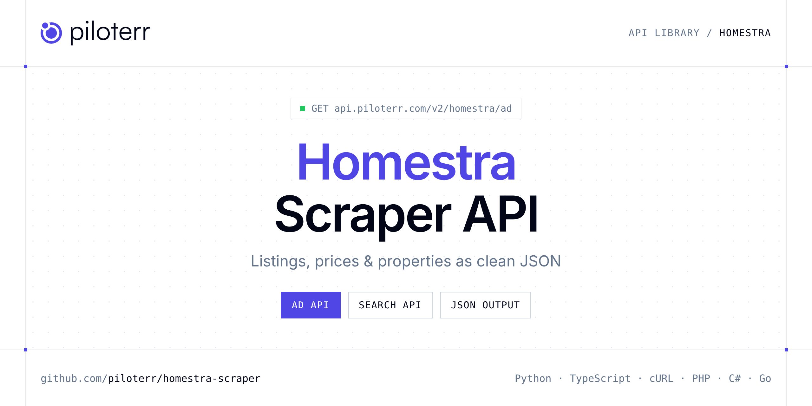

<p align="center">
  <a href="https://www.piloterr.com"></a>
</p>

# Homestra Scraper API

[](https://discord.gg/CFj3ph8aHU) [](https://app.piloterr.com) [](https://app.piloterr.com/openapi) [](LICENSE)

The **Piloterr Homestra Scraper API** lets you extract public data from Homestra as **clean, structured JSON** — no proxies, headless browsers or HTML parsing to maintain. Endpoints available in production:

- **Homestra Ad API** — Retrieve detailed property listing data from Homestra, including price, size, location, features, photos, and nearby properties.
- **Homestra Search API** — Search Homestra property listings using a direct search URL with filters, returning structured results with prices, sizes, locations, and photos.

Use it for property price monitoring, market analytics, investment sourcing or rental yield models.

| Endpoint | Path | Credits | What you get |
|---|---|---|---|
| [Homestra Ad API](#homestra-ad-api) | `/v2/homestra/ad` | 1 | Retrieve detailed property listing data from Homestra, including price, size, location, features, photos, and nearby properties. |
| [Homestra Search API](#homestra-search-api) | `/v2/homestra/search` | 1 | Search Homestra property listings using a direct search URL with filters, returning structured results with prices, sizes, locations, and photos. |

## Table of contents

- [How it works](#how-it-works)
- [Homestra Ad API](#homestra-ad-api)
- [Homestra Search API](#homestra-search-api)
- [Code examples in other languages](#code-examples-in-other-languages)
- [Practical use cases](#practical-use-cases)
- [Why Piloterr?](#why-piloterr)
- [FAQ](#faq)
- [Related scrapers](#related-scrapers)
- [Support](#support)

## How it works

1. **Create a free Piloterr account** and copy your API key from the [dashboard](https://app.piloterr.com).
2. **Send a `GET` (or `POST`) request** to `https://api.piloterr.com/v2/...` with the header `x-api-key: YOUR_API_KEY`.
3. **Receive structured JSON** — Piloterr handles rendering, proxies, retries and parsing.

```bash
export PILOTERR_API_KEY="your-api-key"
pip install requests        # Python
# TypeScript: Node.js 18+ (native fetch), run with `npx tsx file.ts`
```

> Every endpoint accepts both `GET` (query string) and `POST` (JSON body with the same fields).

## Homestra Ad API

Retrieve detailed property listing data from Homestra, including price, size, location, features, photos, and nearby properties.

`GET | POST https://api.piloterr.com/v2/homestra/ad` · **1 credit per request** · [Full reference](https://app.piloterr.com/openapi)

### Request parameters

| Parameter | Type | Required | Description |
|---|---|---|---|
| `query` | string | ✅ | A Homestra property URL or slug. |

### Python example

```python
import json
import os
import requests

response = requests.get(
    "https://api.piloterr.com/v2/homestra/ad",
    headers={"x-api-key": os.environ["PILOTERR_API_KEY"]},
    params={
        "query": "https://homestra.com/property/charming-4-bedroom-stone-house-with-historic-towers-in-idyllic-french-village/",
    },
    timeout=120,
)
response.raise_for_status()
data = response.json()

print(json.dumps(data, indent=2, ensure_ascii=False)[:2000])
```

### TypeScript example

```typescript
type HomestraAd = {
  id?: string;
  city?: string;
  size?: number;
  slug?: string;
  type?: string;
  price?: number;
  title?: string;
  garden?: boolean;
  region?: string;
  status?: string;
  address?: string;
  parking?: boolean;
  basement?: boolean;
  location?: {
    type?: string;
    coordinates?: number[];
  };
  lot_size?: number;
  condition?: string;
  furnished?: boolean;
  created_at?: string;
  country_code?: string;
  swimming_pool?: boolean;
  nearby_properties?: {
    id?: string;
    slug?: string;
    price?: number;
    title?: string;
  }[];
  amount_of_bedrooms?: number;
  featured_photo_url?: string;
  amount_of_bathrooms?: number;
};

const params = new URLSearchParams({
  "query": "https://homestra.com/property/charming-4-bedroom-stone-house-with-historic-towers-in-idyllic-french-village/",
});

const response = await fetch(`https://api.piloterr.com/v2/homestra/ad?${params}`, {
  headers: { "x-api-key": process.env.PILOTERR_API_KEY! },
});
if (!response.ok) throw new Error(`Piloterr error ${response.status}: ${await response.text()}`);

const data = (await response.json()) as HomestraAd;

console.log(JSON.stringify(data, null, 2).slice(0, 2000));
```

<details>
<summary><b>POST variant</b></summary>

```http
POST https://api.piloterr.com/v2/homestra/ad
x-api-key: YOUR_API_KEY
Content-Type: application/json

{"query": "https://homestra.com/property/charming-4-bedroom-stone-house-with-historic-towers-in-idyllic-french-village/"}
```
</details>

### Output example

Example response from the API reference, abridged — real values depend on the page you scrape.

```json
{
  "id": "c6ff90a7-d152-42c9-a1a3-ff0b5cbbcdaf",
  "city": "Civray",
  "size": 240,
  "slug": "charming-4-bedroom-stone-house-with-historic-towers-in-idyllic-french-village",
  "type": "chateau",
  "price": 474500,
  "title": "Charming 4-Bedroom Stone House with Historic Towers in Idyllic French Village",
  "garden": true,
  "region": "Cher",
  "status": "for_sale",
  "address": "France",
  "parking": true,
  "basement": true,
  "location": {
    "type": "Point",
    "coordinates": [
      46.94515,
      2.17684
    ]
  },
  "lot_size": 3933,
  "condition": "good",
  "furnished": false,
  "created_at": "2024-06-01T17:43:55.361Z",
  "country_code": "fr",
  "swimming_pool": false,
  "nearby_properties": [
    {
      "id": "a08d69ea-888e-4ed2-8bbd-6a731efd1bd5",
      "slug": "charming-3-bedroom-home-in-aquitaine-france",
      "price": 275000,
      "title": "Charming 3 Bedroom Home in Aquitaine, France"
    }
  ],
  "amount_of_bedrooms": 4,
  "featured_photo_url": "https://storage.googleapis.com/homestra-images/property-image-cab7dff4-ce7b-4f20-9d35-2df09ae9d283-1717266265.jpg",
  "amount_of_bathrooms": 1
}
```

### Response fields

| Field | Type | Description |
|---|---|---|
| `id` | string |  |
| `city` | string |  |
| `size` | integer |  |
| `slug` | string |  |
| `type` | string |  |
| `price` | integer |  |
| `title` | string |  |
| `garden` | boolean |  |
| `region` | string |  |
| `status` | string |  |
| `address` | string |  |
| `parking` | boolean |  |
| `basement` | boolean |  |
| `location` | object |  |
| `location.type` | string |  |
| `location.coordinates` | number[] |  |
| `lot_size` | integer |  |
| `condition` | string |  |
| `furnished` | boolean |  |
| `created_at` | string |  |
| `country_code` | string |  |
| `swimming_pool` | boolean |  |
| `nearby_properties[]` | object[] |  |
| `nearby_properties[].id` | string |  |
| `nearby_properties[].slug` | string |  |

## Homestra Search API

Search Homestra property listings using a direct search URL with filters, returning structured results with prices, sizes, locations, and photos.

`GET | POST https://api.piloterr.com/v2/homestra/search` · **1 credit per request** · [Full reference](https://app.piloterr.com/openapi)

### Request parameters

| Parameter | Type | Required | Description |
|---|---|---|---|
| `query` | string | ✅ | A valid Homestra search URL with optional filters. |

### Python example

```python
import json
import os
import requests

response = requests.get(
    "https://api.piloterr.com/v2/homestra/search",
    headers={"x-api-key": os.environ["PILOTERR_API_KEY"]},
    params={
        "query": "https://homestra.com/list/houses-for-sale/?maximum-price=900000&minimum-price=75000&page=1",
    },
    timeout=120,
)
response.raise_for_status()
data = response.json()

print(json.dumps(data, indent=2, ensure_ascii=False)[:2000])
```

### TypeScript example

```typescript
type HomestraSearch = {
  id?: string;
  city?: string;
  size?: number;
  slug?: string;
  type?: string;
  price?: number;
  title?: string;
  status?: string;
  address?: string;
  location?: {
    type?: string;
    coordinates?: number[];
  };
  lot_size?: number;
  photo_url?: string;
  country_code?: string;
  listing_date?: string;
}[];

const params = new URLSearchParams({
  "query": "https://homestra.com/list/houses-for-sale/?maximum-price=900000&minimum-price=75000&page=1",
});

const response = await fetch(`https://api.piloterr.com/v2/homestra/search?${params}`, {
  headers: { "x-api-key": process.env.PILOTERR_API_KEY! },
});
if (!response.ok) throw new Error(`Piloterr error ${response.status}: ${await response.text()}`);

const data = (await response.json()) as HomestraSearch;

console.log(JSON.stringify(data, null, 2).slice(0, 2000));
```

<details>
<summary><b>POST variant</b></summary>

```http
POST https://api.piloterr.com/v2/homestra/search
x-api-key: YOUR_API_KEY
Content-Type: application/json

{"query": "https://homestra.com/list/houses-for-sale/?maximum-price=900000&minimum-price=75000&page=1"}
```
</details>

### Output example

Example response from the API reference, abridged — real values depend on the page you scrape.

```json
[
  {
    "id": "0d45a754-0e49-4c35-b0b6-bf1dba0d47cd",
    "city": "Valderice",
    "size": 114,
    "slug": "spacious-3-bed-detached-home-with-sea-views-and-guest-studio-in-valderice-trapani",
    "type": "house",
    "price": 250000,
    "title": "Spacious 3-Bed Detached Home with Sea Views and Guest Studio in Valderice, Trapani",
    "status": "for_sale",
    "address": "Valderice, Trapani, Sicily, Italy",
    "location": {
      "type": "Point",
      "coordinates": [
        38.04061,
        12.62553
      ]
    },
    "lot_size": 800,
    "photo_url": "https://storage.googleapis.com/homestra-images/property-image-e4e958d4-fdc4-430c-a6e3-aee2cd7b6fd0-1721847180.jpg",
    "country_code": "it",
    "listing_date": "2024-07-25T22:26:03.577Z"
  },
  {
    "id": "41d7f3ef-6d42-4fb2-9ddf-1d07ea0d683f",
    "city": "Carvoeiro",
    "size": 330,
    "slug": "peaceful-3-bedroom-villa-with-panoramic-views-in-barroselas-portugal",
    "type": "house",
    "price": 349000,
    "title": "Peaceful 3-Bedroom Villa with Panoramic Views in Barroselas, Portugal",
    "status": "for_sale",
    "address": "Minho, Barroselas, Portugal",
    "location": {
      "type": "Point",
      "coordinates": [
        41.65043,
        -8.67458
      ]
    },
    "lot_size": 1673,
    "photo_url": "https://storage.googleapis.com/homestra-images/property-image-e4e958d4-fdc4-430c-a6e3-aee2cd7b6fd0-1721847180.jpg",
    "country_code": "pt",
    "listing_date": "2024-07-25T21:30:10.404Z"
  }
]
```

### Response fields

| Field | Type | Description |
|---|---|---|

## Code examples in other languages

Ready-to-run examples live in the [`examples/`](examples) folder. Each one reads your key from the `PILOTERR_API_KEY` environment variable.

| Language | Ad | Search |
|---|---|---|
| cURL (Bash) | [`ad`](examples/curl/ad.sh) | [`search`](examples/curl/search.sh) |
| PHP | [`ad`](examples/php/ad.php) | [`search`](examples/php/search.php) |
| C# | [`ad`](examples/csharp/Ad.cs) | [`search`](examples/csharp/Search.cs) |
| Go | [`ad`](examples/go/ad.go) | [`search`](examples/go/search.go) |
| Java | [`ad`](examples/java/AdExample.java) | [`search`](examples/java/SearchExample.java) |
| Ruby | [`ad`](examples/ruby/ad.rb) | [`search`](examples/ruby/search.rb) |
| Node.js | [`ad`](examples/nodejs/ad.mjs) | [`search`](examples/nodejs/search.mjs) |

## Practical use cases

- **Price monitoring** — Track asking prices and price drops per area.
- **Market analytics** — Measure inventory, days on market and price per m² / sqft.
- **Investment sourcing** — Detect undervalued properties as soon as they are listed.
- **Rental yield models** — Combine sale and rent listings to estimate yields.
- **Proptech products** — Power portals, valuation tools and alerts with structured listings.

## Why Piloterr?

- **No infrastructure** — no proxies, headless browsers or CAPTCHA solving to run yourself.
- **Structured JSON** — stable, documented fields instead of brittle HTML selectors.
- **Pay per request** — transparent credit cost per endpoint, failed requests are retried for you.
- **One API key, hundreds of sources** — Homestra plus many other e-commerce, search and company data endpoints in the [Piloterr library](https://www.piloterr.com/library).
- **Any language** — plain HTTPS + JSON, with examples for Python, TypeScript, cURL, PHP, C#, Go, Java, Ruby and Node.js.

## FAQ

### Is it legal to scrape Homestra?

Collecting publicly available data is generally allowed in many jurisdictions, but rules depend on your country, the data you collect and how you use it. Avoid personal data unless you have a lawful basis, respect the website's terms where they apply, and get legal advice for your specific use case. This is not legal advice.

### Do I need proxies or a headless browser?

No. Piloterr handles rendering, proxy rotation and retries on its side. You only send an HTTPS request with your `x-api-key` header and receive JSON.

### How much does a request cost?

Credits per call: `/v2/homestra/ad` **1**, `/v2/homestra/search` **1**. See the [Piloterr website](https://www.piloterr.com) for plans.

### What data does the Homestra API return?

Each endpoint returns structured JSON: **Homestra Ad** — `id`, `city`, `size`, `slug`, `type`, `price`; **Homestra Search** — see the reference.

### Which languages are supported?

Any language that can make an HTTP request. This README shows Python and TypeScript; the [`examples/`](examples) folder contains cURL, PHP, C#, Go, Java, Ruby and Node.js.

## Related scrapers

- [Apartments Scraper API](https://github.com/piloterr/apartments-scraper)
- [Argenprop Scraper API](https://github.com/piloterr/argenprop-scraper)
- [Centris Scraper API](https://github.com/piloterr/centris-scraper)
- [Fotocasa Scraper API](https://github.com/piloterr/fotocasa-scraper)
- [Funda Scraper API](https://github.com/piloterr/funda-scraper)
- [Idealista Scraper API](https://github.com/piloterr/idealista-scraper)
- [All Piloterr scrapers on GitHub](https://github.com/piloterr)

## Support

- 💬 Join the [Piloterr Discord](https://discord.gg/CFj3ph8aHU) to ask questions and share what you build.
- 📚 Browse the [API reference (OpenAPI)](https://app.piloterr.com/openapi) and the [Piloterr library](https://www.piloterr.com/library).
- 🔑 [Get your API key](https://app.piloterr.com).

---

<p align="center">
  <a href="https://www.piloterr.com">
    <picture>
      <source media="(prefers-color-scheme: dark)" srcset="images/logo-dark.svg">
      
    </picture>
  </a>
  <br>
  <sub>Built by <a href="https://www.piloterr.com">Piloterr</a> — web scraping APIs for e-commerce, search, real estate and more, one API key.</sub>
</p>

<sub>Homestra is a trademark of its respective owner. This repository is not affiliated with or endorsed by Homestra. Examples are released under the MIT license.</sub>
